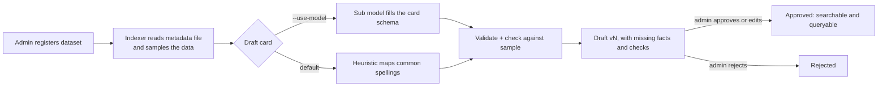

# Data catalog

The data lives as files in S3 buckets, and each dataset ships its own metadata file in whatever YAML or JSON layout its
owner already uses. There is no common convention. Alchemist keeps a small internal catalog over those files, and the
agent can find and query data only through it.

The data team builds and runs the catalog and assigns its admins.

## Three parts

| Part | Where it lives | Maintained by | Holds |
| --- | --- | --- | --- |
| Registry | Alchemist's database | catalog admins | one row per dataset: id, S3 prefix, file glob, format, plant, metadata file path, owner, sensitivity, status |
| Metadata file | next to the data, e.g. `s3://plant-data/historian/line2/_meta.yaml` | dataset owner | whatever the owner writes: description, columns, units, ranges, keys, quirks |
| Catalog card | Alchemist's database, versioned | drafted by the indexer, approved by an admin | a fixed schema (`alchemist.card/v1`) the agent searches and the views are built from |

## From a free-form file to a card



1. **Register.** An admin adds the dataset with its prefix, glob, format (`parquet`, `csv` or `json`), plant and
   metadata path.
2. **Index.** The indexer reads the metadata file as text, samples up to 200 rows with DuckDB, and drafts a card. With
   `--use-model` the small-jobs model (`ALC_SMALL_MODEL`) drafts it and is told to leave unknown fields empty and list them in
   `missing`; without it a heuristic maps common spellings (`desc`, `units`, `eng_unit`, `tz`, `join_on`, `tags`,
   `fields`, and so on) onto the schema. Metadata text is treated as data, never as instructions.
3. **Check.** The draft is validated against the schema and checked against the sample: does every named column exist,
   and does more than 1% of the sample fall outside a stated valid range? Results are attached to the draft.
4. **Review.** An admin approves the draft as is, approves an edited version, or rejects it. Only approved cards are
   searchable or queryable.
5. **Re-index on change.** The indexer records the metadata file's ETag. Indexing again drafts a new version only when
   the ETag changed (or with `--force`).

## What a card holds

`description`, `grain`, `time_zone`, `time_meaning`, `join_keys`, `refresh_lag`, `quirks`, `example_queries`, a list of
`columns` (name, type, unit, description, valid range, exposure) and `missing`, the facts the drafter could not find.

Owners who want better answers can include the fields that help the agent most. Any layout works; this one maps
directly:

```yaml
description: Process tags of extrusion Line 2 from the plant historian, one-minute averages.
grain: 1 minute
time_zone: UTC
time_meaning: start of the one-minute interval
join_keys: [line, ts]
quirks:
  - TT-204 drops out for a few hours on some days; gaps are null values, not zeros.
columns:
  - name: barrel_temp_c
    description: barrel zone 3 melt temperature, sensor TT-204
    unit: degC
    valid_range: [180, 260]
  - name: operator_name
    never_to_model: true
  - name: crew
    pseudonymise: true
```

## Column exposure

Each column has one exposure, which decides how it appears in the `ds.<dataset>` view the agent queries:

| Exposure | In the view | Use for |
| --- | --- | --- |
| `model` | as is | process values, lot ids, timestamps |
| `pseudonymise` | replaced by a keyed hash (`ALC_PSEUDONYM_KEY`) | crew or person identifiers that are useful for grouping |
| `never_to_model` | left out | personal names, prices, recipe secrets |

The heuristic sets `never_to_model` for columns flagged `never_to_model`, `sensitive`, `pii` or `secret`, and
`pseudonymise` for `pseudonymise`, `pseudonymize` or `pseudonymous`. An explicit `exposure:` field wins.

## Querying through views

The agent never sees a raw S3 path. When a query runs, the data tool:

- parses the SQL with DuckDB's parser and accepts only one `SELECT` whose tables are `ds.<dataset>` views the run may
  read (or its own CTEs), with no table functions such as `read_parquet` and no file-reading functions;
- expands the dataset's glob once and builds the view on that explicit file list, recording each object's key, ETag,
  size and modified time;
- runs on a DuckDB connection locked to the dataset roots (`allowed_directories`, `enable_external_access = false`,
  `lock_configuration = true`), so code in the kernel cannot widen it.

A dataset tagged with plant `global` (shared data such as raw-material specs) is readable by every run.

## Feedback and health

When the agent hits a gap it calls `suggest_catalog_fix`; engineers can file suggestions too. The owner or an admin
edits the metadata file; the agent never does. `alchemist catalog health` lists, per dataset, the approved version,
whether a draft is waiting for review, the missing facts, and whether the metadata file is missing.

See the [catalog admin guide](../guides/catalog-admin.md) for the commands.
