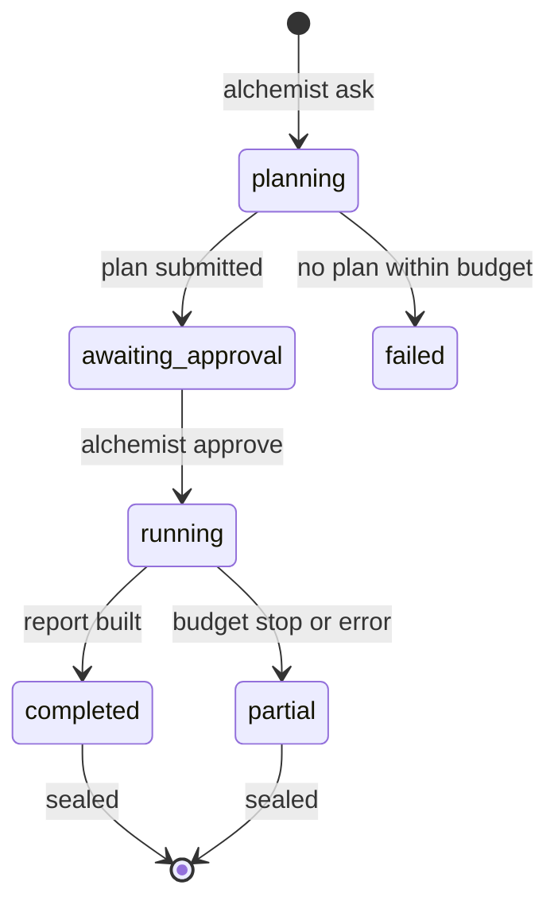

# How a run works

A **question** belongs to a project in a workspace. Each attempt to answer it is a **run**, with its own folder that is
sealed when the run ends. Replays and reruns are new runs that point at their parent; a sealed folder never changes.

## 1. Plan

`alchemist ask` checks the user's access, creates the question and run folders, and starts the agent with three tools
only: `search_catalog`, `search_knowledge` and `submit_plan`. The agent cannot query data at this stage.

The plan states the metric, the scope (period and a baseline period, with the reason for the baseline), and a list of
hypotheses. Each hypothesis has a cause, a method, the datasets it needs and where the idea came from (an FMEA, a past
investigation). "No abnormality" is always one of the hypotheses. A plan that names a dataset the run may not read is
rejected back to the agent.

The run then stops with status `awaiting_approval`.

## 2. Approve

The person who asked (or an admin) reads the plan with `alchemist status <run-id> --plan` and approves it, optionally
with an edited plan file. Approval pins what the run may read:

- `inputs/views.json` lists each queryable dataset with its glob, format, plant, approved card version and the exposure
  of every column.
- `inputs/knowledge_index.json` and `inputs/knowledge/*.json` hold the structured knowledge for the run's plants.

## 3. Analyse

A fresh Jupyter kernel starts in the run folder. Its first cells set the run mode and seed and initialise the `alc`
helpers. The agent then works with these tools:

`run_query`
:   One read-only `SELECT` over `ds.<dataset>` views, checked by DuckDB's own parser. The dataset's glob is expanded
    once and the query runs on that explicit file list; every source object's key, ETag, size and modified time is
    recorded. The result is saved as `inputs/<sha256>.parquet` and loaded in the kernel as `df_<query_id>`. The model
    sees only the row count, column types, summary statistics and the first rows.

`run_python`
:   A cell in the persistent kernel. Output is truncated before it reaches the model; figures are saved to `figures/`.

`record_finding`
:   A claim plus a Python expression that computes its supporting number **in the kernel**. The model never types the
    number; it is evaluated, hashed and written to `findings.json`.

`suggest_catalog_fix`
:   Files a suggestion against a dataset's card (unknown unit, wrong time zone) for admins to review.

Every call becomes a notebook cell with its outputs, saved after each cell, so the notebook is the analysis itself.

Shared helpers keep analyses consistent: `alc.align()` joins lots to the process window that produced them, shifted by
the residence time; `alc.effect()` gives the difference in means with Welch's t-test and Cohen's d; `alc.knowledge()`
reads structured knowledge.

## 4. Review

When the agent calls `finish_analysis`, a second model (the reviewer, `ALC_SUB_MODEL` by default) reads the plan, a
digest of the notebook and the findings once, and returns issues such as unsupported claims, confounders and data gaps.
The agent addresses them before reporting. The reviewer runs once, at the end, not on the plan.

## 5. Report

`build_report` writes the conclusion card and the HTML report. The conclusion uses placeholders such as `{{F2}}` that
are filled from `findings.json`. A measured number typed straight into the text (`4.7 %`, `2 °C`, `3.63`) fails the
check and the report is sent back to the agent.

## 6. Seal

`manifest.json` records the question, plan, access decision, environment (Python, package versions, `uv.lock` hash,
image digest), models and prompt version, catalog card versions, citations, queries, cells and finding hashes. Then
`SEALED` lists a SHA-256 for every file in the run folder, and the hash of `SEALED` itself goes into the catalog
database and the audit log. `alchemist verify <run-id>` checks a folder against it.

## Budgets and partial results

Each step of a run has a tool-call budget (`ALC_MAX_STEPS`, default 60) and an output-token budget (`ALC_MAX_OUTPUT_TOKENS`, default
400,000). If the analysis stops early, the run still builds a partial report from the findings recorded so far, says
why it stopped, and is sealed with status `partial`.

## Replay and rerun

`alchemist replay <run-id>` verifies the parent's seal, copies its `inputs/` into a new run, and re-executes the
parent's code cells:

| Mode | `alc.query` does | Result |
| --- | --- | --- |
| `replay` (default) | reads the stored snapshot | every finding's hash must match the parent, or the run is marked `mismatch` |
| `rerun` | runs the same SQL on current data | reports, per query, rows then and now, whether the result changed, and how many source objects changed or are new |

See [Reproducibility](reproducibility.md) for what this guarantees and what it does not.
