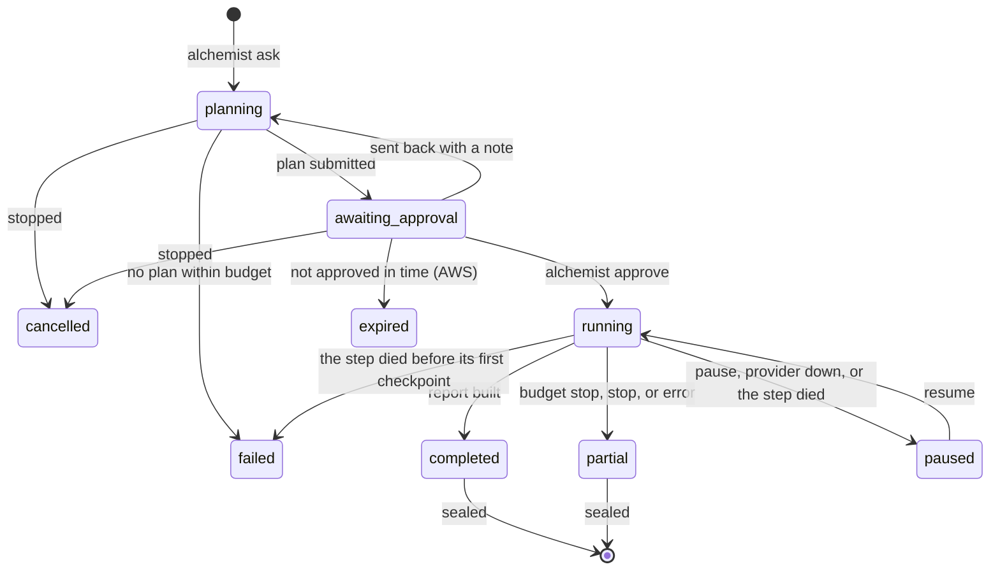

# How a run works

A **question** belongs to a project in a workspace. Each attempt to answer it is a **run**, with its own folder that is
sealed when the run ends. Replays and reruns are new runs that point at their parent; a sealed folder never changes.

## 1. Plan

`alchemist ask` checks the user's access, creates the question and run folders, and starts the agent with three tools
only: `search_catalog`, `search_knowledge` and `submit_plan`. The agent cannot query data at this stage.

The plan states the metric, the scope (period and a baseline period, with the reason for the baseline), and a list of
hypotheses. Each hypothesis has a cause, a method, the datasets it needs and where the idea came from (an FMEA, a past
investigation). "No abnormality" is always one of the hypotheses. A plan that names a dataset the run may not read is
rejected back to the agent.

The run then stops with status `awaiting_approval`.

## 2. Approve

The person who asked (or an admin) reads the plan with `alchemist status <run-id> --plan` and approves it, optionally
with an edited plan file. Approval pins what the run may read:

- `inputs/views.json` lists each queryable dataset with its glob, format, plant, approved card version and the exposure
  of every column.
- `inputs/knowledge_index.json` and `inputs/knowledge/*.json` hold the structured knowledge for the run's plants.

## 3. Analyse

A fresh Jupyter kernel starts in the run folder. Its first cells set the run mode and seed and initialise the `alc`
helpers. The agent then works with these tools:

`run_query`
:   One read-only `SELECT` over `ds.<dataset>` views, checked by DuckDB's own parser. The dataset's glob is expanded
    once and the query runs on that explicit file list; every source object's key, ETag, size and modified time is
    recorded. The result is saved as `inputs/<sha256>.parquet` and loaded in the kernel as `df_<query_id>`. The model
    sees only the row count, column types, summary statistics and the first rows; people following the run also see a
    sparkline of each numeric column (kept in the transcript, never sent to the model).

`run_python`
:   A cell in the persistent kernel. Output is truncated before it reaches the model; figures are saved to `figures/`
    and shown to people following the run as soon as the cell finishes. The prompt asks for a figure at the data-health
    check and at each hypothesis test.

`record_finding`
:   A claim plus a Python expression that computes its supporting number **in the kernel**. The model never types the
    number; it is evaluated, hashed and written to `findings.json`.

`suggest_catalog_fix`
:   Files a suggestion against a dataset's card (unknown unit, wrong time zone) for admins to review.

Every call becomes a notebook cell with its outputs, saved after each cell, so the notebook is the analysis itself.

The statistics that decide the answer come from [penguineer](../guides/penguineer.md): lining lots up with the process
window that produced them, comparing two groups, data health, dead times and root-cause ranking. Hand-written code in
`run_python` is for plots and checks no penguineer command covers; `alc.knowledge()` reads structured knowledge.

## 4. Review

When the agent calls `finish_analysis`, a second model (the reviewer, `ALC_REVIEWER_MODEL`) reads the plan, a
digest of the notebook and the findings once, and returns issues such as unsupported claims, confounders and data gaps.
The agent addresses them before reporting. The reviewer runs once, at the end, not on the plan.

## 5. Report

`build_report` writes the conclusion card and the HTML report. The conclusion uses placeholders such as `{{F2}}` that
are filled from `findings.json`. A measured number typed straight into the text (`4.7 %`, `2 °C`, `3.63`) fails the
check and the report is sent back to the agent.

## 6. Seal

`manifest.json` records the question, plan, access decision, environment (Python, package versions, `uv.lock` hash,
image digest), models and prompt version, catalog card versions, citations, queries, cells and finding hashes. Then
`SEALED` lists a SHA-256 for every file in the run folder, and the hash of `SEALED` itself goes into the catalog
database and the audit log. `alchemist verify <run-id>` checks a folder against it.

## Budgets and partial results

Each step of a run has a tool-call budget (`ALC_MAX_STEPS`, default 60) and an output-token budget (`ALC_MAX_OUTPUT_TOKENS`, default
400,000), and the analysis has a time limit (`ALC_MAX_RUN_MINUTES`, default 120 minutes). If the analysis stops
early on a step or token budget, the run still builds a partial report from the findings recorded so far, says why it
stopped, and is sealed with status `partial`. At the time limit it pauses instead, with a preliminary report, so a
person can give it more time (see [When time runs out](#when-time-runs-out)).

### Time limit

The time limit counts the analysis's working time: from when a worker starts it until it finishes, carried over when
a paused run resumes. Time waiting for approval, paused, or queued for a worker does not count. Like the other budgets
it is checked before each model call, so a long query or cell can run a little past it.

Whoever approves the plan can set the run's limit (the **Time limit** field next to Approve, or
`alchemist approve --time-limit MINUTES`), up to `ALC_MAX_RUN_MINUTES_CAP` (default 480). Left empty, the run gets the
default. The run records its limit in the approved plan, so changing the default later does not change runs already
approved. The run page shows the minutes used against it under **Run limits**.

#### When time runs out

Near the end (the last tenth of the limit, at most 10 minutes), the agent is told that time is nearly up: stop
exploring, record what it can support, have its findings reviewed and build a report with its best conclusion so far,
saying what is still open. That report is marked **preliminary**. If the agent has not built one when the limit is
reached, a preliminary report listing the findings so far is built for it.

The run then **pauses**, unsealed, with the preliminary conclusion on its page, and waits for a person:

- **Continue for N more minutes** (`POST /runs/{id}:resume` with `{"more_minutes": N}`, up to the cap; left out, the
  default) resumes the same run from where it stopped: the notebook is re-run on its stored snapshots, and the agent
  continues the same conversation with its findings, told how much more time it has. The new limit is the time used
  plus N; the extension is audited (`run.extend`) and shows in the run's notes. When the agent finishes, its report
  replaces the preliminary one; near the new limit it is told to wrap up again.
- **Finish with this report** (Stop) seals the run as `partial` with the preliminary report as it stands, noting that
  it was finished without more time.

Admins change the default, the cap and the per-step budgets on the admin **Models and limits** page. A value saved
there overrides the variable, and every change is audited.

## Stopping, pausing and failures

Stop (`POST /runs/{id}:stop`, the Stop or Cancel button) depends on where the run is:

| Status | What stop does |
| --- | --- |
| `planning`, `awaiting_approval` | the run is `cancelled` at once; nothing was read from the lake yet. In AWS its workflow execution is stopped too |
| `running` | the agent stops after its current step (a cell can take up to 15 minutes), builds a partial report of the findings so far and seals the run as `partial` |
| `paused` | the run is resumed once to build and seal that partial report |

### Pause and resume

A plan waits for approval at no cost (in AWS for up to `workflow.approval_timeout_days`, then the run is `expired`).
A running analysis can be paused too (`POST /runs/{id}:pause`, the Pause button):

- **Checkpoint.** After every completed step the analysis writes `logs/checkpoint.json`: the model conversation (without
  image payloads), the budget used so far, the query and finding counters, and how many notebook cells exist. The
  notebook itself is saved after every cell, as before.
- **Pause.** The agent stops after its current step. The run is `paused`, nothing is reported or sealed, and its
  tasks end (in AWS the execution finishes; a separate sandbox task is stopped), so a paused run costs nothing.
- **Resume** (`POST /runs/{id}:resume`). A new analysis step starts a fresh kernel, reads the notebook back up to the
  checkpoint and re-runs its code cells in replay mode, so every query reads the snapshot it stored and nothing reads
  the lake again; then the kernel switches back to live mode and the conversation continues where it stopped. The
  notebook gets one note where it resumed, and the transcript carries on in the same file. Re-running the cells takes
  as long as they took the first time.

The same checkpoint makes a run survive its step dying:

- In AWS, `Analyse` is retried up to `workflow.analysis_retries` times (default 2) when its task fails or hits
  `workflow.analysis_timeout_hours`, and each attempt resumes from the checkpoint. A run can therefore go past the
  timeout, and each attempt gets fresh run credentials.
- If no retry is left, or a local server restarted under the step, the API's reconciler (every
  `ALC_RECONCILE_SECONDS`) pauses the run, so its owner can resume it. A model provider that stays unavailable past
  `ALC_MODEL_RETRY_SECONDS` pauses the run as well.
- A step that dies before its first checkpoint, or a planning step, is closed as `failed`.

Work after the last checkpoint is lost: if a step dies after a cell ran but before the step was saved, that cell is
dropped from the notebook and any finding it recorded is removed, and the agent does that step again.

With a separate sandbox, resume starts a new sandbox task with a new broker grant. A retry of `Analyse` reuses the
running sandbox task, whose kernel is rebuilt the same way; if the sandbox task itself died, the retries fail and the
run is paused for a person to resume.

## Steering a run with notes

The person who asked (or an admin) can tell the agent something while it works, without stopping it: "the melt-flow
sensor drifted in March, check it against the lab values", "add the resin dryer as a cause". There are two ways.

- **A note** (`POST /runs/{id}/notes`, the Steer the agent box on a planning, running or paused run). Notes are audit
  events (`run.note`), so the API can add one whichever process runs the step. Before every model call the step
  checks for new notes, as it checks for pause and stop, and appends them to the end of the conversation; the agent
  takes them into account from that call on. A paused run receives its notes when it resumes, and a note left while
  the plan waits for approval reaches the analysis when it starts. A note does not widen what the run may read.
- **Send the plan back** (`POST /runs/{id}/plan:send-back`, Send back with a note on the approval screen). The run
  returns to `planning`, and the planning step continues its saved conversation (`logs/plan_checkpoint.json`) with
  the note, so the agent revises the plan rather than starting over. The next version comes back for approval with
  `revises` set to the version it replaces; earlier versions are kept in `logs/plan_history.json`.

Each note is delivered once. The step records every delivery in `logs/steering.json` (who wrote the note, its text,
the phase, and the step and model call before which the agent read it) and in its checkpoint, so a note given in a
turn that never completed is given again when the run resumes. The manifest's `steering` lists every note with its
delivery, or `null` when the run ended before the agent read it; the report has a section for them, and the agent
steps show each note where the agent received it. Notes steer the agent but are not evidence: the notebook and
findings show what it computed after each note. A replay re-executes the notebook and never asks the model again, so
the notes do not change a replay.

## Many people at once

Every run has its own folder, kernel and (in AWS) its own tasks and credentials, so runs do not see each other. What
they share:

- **The model quota.** All runs call the same Bedrock account. Throttled calls are retried with backoff for up to
  `ALC_MODEL_RETRY_SECONDS` (default 300) before the step ends; ask for a quota increase before a wider rollout.
- **Capacity and cost.** At most `ALC_MAX_ACTIVE_RUNS_PER_USER` (default 3) runs per person plan or analyse at once,
  and `ALC_MAX_ACTIVE_RUNS` in total (default no limit); plans waiting for approval do not count. Over the limit the
  API answers 429.
- **The database.** Status changes are compare-and-set, so a plan approved twice (two tabs, a double click) starts
  once, and a cancel and an approval at the same moment cannot both win. On AWS the database is Aurora
  PostgreSQL, shared by every API and worker task; SQLite (the local default) locks the whole file on each write, so
  keep it to one machine.

## Running many runs in the background

Asking a question, approving a plan or resuming a run returns at once: the step runs in the background, and the web
app follows it through the run's event stream. Where it runs is the launcher (`ALC_LAUNCHER`):

| Launcher | Where steps run | Fits |
| --- | --- | --- |
| `local` (default) | threads in the API process, `ALC_LOCAL_WORKERS` at a time | one person trying it on a laptop |
| `queue` | `alchemist worker` processes that take steps from the run queue in the database | docker compose, Kubernetes, and AWS with `workflow.launcher: queue` |
| `step-functions` | one Step Functions execution per run, one Fargate task per step | AWS (the default there) |

With the queue, the API only records each step in the `run_jobs` table. Each worker takes the oldest waiting step
(`--concurrency` at a time), so more workers means more runs going at once: `docker compose up --scale worker=4`, more
replicas in Kubernetes (or KEDA on the queue's length), or an ECS service that scales on the backlog. A run has one
step running at a time, and a step stays queued until a worker is free; the run page shows how many steps are ahead.

Everything you do to a run goes through the database, so it reaches the step whichever worker runs it: stop, pause
and resume, notes, sending a plan back. Nothing has to be routed to the right machine.

A worker records a heartbeat for each step it runs. If a worker dies (killed, out of memory, the machine restarted),
its steps stop sending heartbeats; after `ALC_JOB_LEASE_SECONDS` (default 120) the API or another worker queues the
step again, up to `ALC_JOB_RETRIES` times (default 2). An analysis then continues from its last checkpoint and a
planning step from its saved conversation, so little work is lost. After the retries the run is paused if it can
resume, and failed otherwise. A worker that is stopped normally (`docker compose stop`, a rolling update) finishes
the steps in hand first, within its grace period.

On one computer the same setup works with SQLite: `ALC_LAUNCHER=queue alchemist serve` in one terminal and
`alchemist worker` in another (or `ALC_QUEUE_EMBEDDED_WORKERS=2` to run workers inside the API). The queue then also
survives a restart of the API.

## Replay and rerun

`alchemist replay <run-id>` verifies the parent's seal, copies its `inputs/` into a new run, and re-executes the
parent's code cells:

| Mode | `alc.query` does | Result |
| --- | --- | --- |
| `replay` (default) | reads the stored snapshot | every finding's hash must match the parent, or the run is marked `mismatch` |
| `rerun` | runs the same SQL on current data | reports, per query, rows then and now, whether the result changed, and how many source objects changed or are new |

See [Reproducibility](reproducibility.md) for what this guarantees and what it does not.
