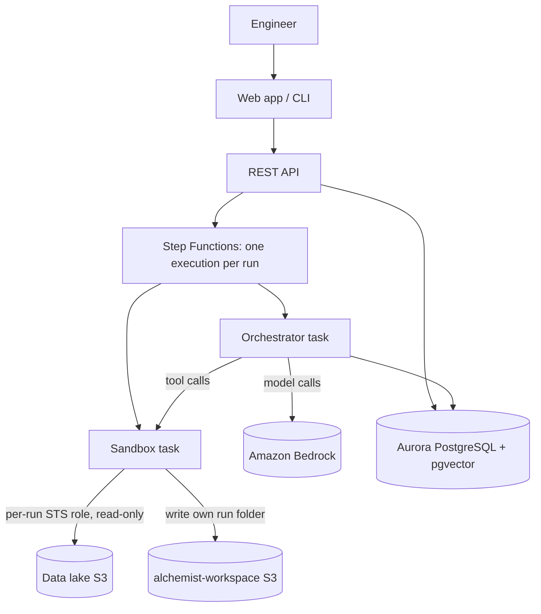

# MVP and target design

This repository is the MVP of the design. Two design documents describe the full system:

- [Product design](https://claude.ai/code/artifact/860e0a60-e35c-4351-b5ec-2cfbb2053c95): what Alchemist does, for whom,
  and the guardrails around it.
- [Technical design](https://claude.ai/code/artifact/22c0c2a8-5aa9-407b-9303-544974b79b6b): the AWS architecture,
  data layouts, interfaces and build order.

Where they disagree, the product design decides *what* and the technical design decides *how*.

## Target architecture in one paragraph

Alchemist runs as an AWS-native service in the company's own account. A web app and REST API run on ECS Fargate; each
run is one Step Functions execution, so waiting for plan approval costs nothing. Model access and data access are
split: an **orchestrator** task calls Bedrock but cannot read the lake, and a **sandbox** task reads the lake with
short-lived per-run credentials but has no route to Bedrock or the internet. Aurora PostgreSQL with pgvector indexes the
catalog, knowledge and runs; the S3 run folder stays the source of truth.

## What is enforced where

| Rule | MVP | Target design |
| --- | --- | --- |
| Plant groups decide data, workspaces decide projects | identity-provider groups (or local users in `access.yaml`); tool layer, plus per-run STS credentials enforced by S3 when `ALC_RUN_ROLE_ARN` is set | same, always with per-run credentials |
| Only approved, registered datasets are queryable | views built from approved cards; SQL guard | same, plus the run role can only read registered prefixes |
| Hidden and pseudonymised columns | dropped or keyed-hashed in the views | same, HMAC with a per-deployment secret |
| Plant data goes only to approved model providers | `ALC_ALLOWED_PROVIDERS` allow-list | allow-list of inference profile ARNs; Bedrock reached through a VPC endpoint |
| The kernel cannot reach the model or the internet | not enforced (local process) | separate Fargate task, no route to Bedrock, no NAT |
| Sealed runs cannot change | SEALED written once (S3 conditional put), run credentials may not write it, SHA-256 tamper evidence | same |
| Catalog and run index | SQLite | Aurora PostgreSQL + pgvector |
| Document search | keyword ranking | hybrid (embeddings + full text) |
| Plan approval and progress | CLI | web app with plan editing and live progress |

## Not in the MVP yet

- Web app and REST API.
- Step Functions orchestration and the AWS infrastructure code (CDK).
- The separate sandbox container. The credential broker exists; refreshing run credentials past one hour does not.
- pgvector search and knowledge ingestion from PDFs.
- PDF reports.
- Rerunning on a new scope (`rescope` mode).
- The evaluation benchmark of 20 to 30 past investigations (hits@1, hits@3, unsupported claims, replay match rate,
  cost and time per question).

## Delivery phases

1. **Foundations.** Accounts, VPC and endpoints, buckets, Aurora, SSO, Bedrock profiles, sandbox image, credential
   broker. Gate: a plant-A user's run cannot read plant-B data, proven at S3.
2. **Catalog and data path.** Registry, indexer, card review console, views, `run_query` with snapshots. Gate: the
   pilot line's datasets have approved cards and a query's snapshot replays byte for byte.
3. **Agent MVP.** Orchestrator, tools, plan approval, notebook, findings, report, seal, replay, on one line and one
   question type. Gate: benchmark baseline recorded, replay match 100%.
4. **Pilot.** Engineers on the pilot line use it for real questions; verdicts feed past investigations.
5. **Scale out.** More lines, plants and workspaces; knowledge ingestion at scale; agent access over MCP.

The open questions for each design (bucket versioning, plant prefixes, identity provider, region, retention, data
sizes) are tracked in the design documents.
