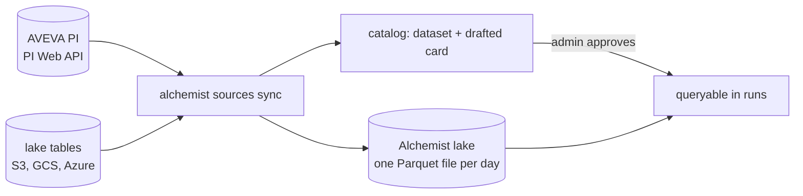
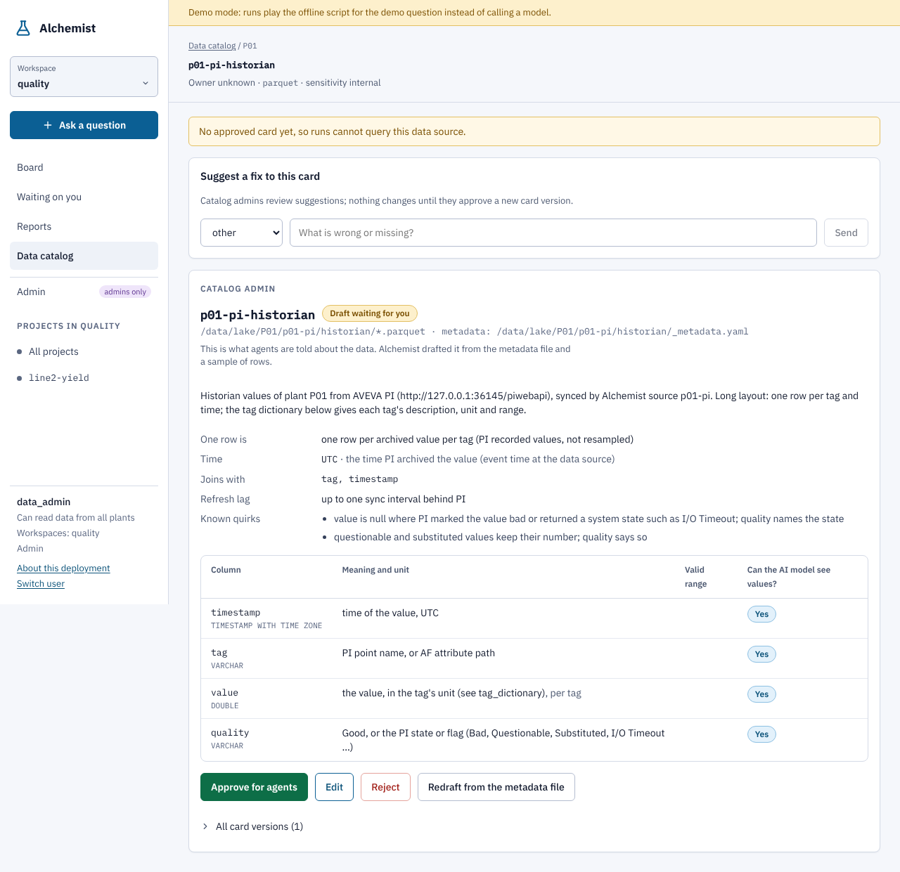

# Data sources

Alchemist answers questions over datasets registered in its [data catalog](../concepts/data-catalog.md). Where a
plant's data already sits in the lake as Parquet, register it directly (`alchemist catalog register`). Where it sits in
the historian, or in a lake table with its own column names, time zone or format, a **data source** keeps a copy in the
lake for Alchemist, using [penguineer's connectors](https://kausalflow.com/penguineer/guides/data-sources/):

| Kind | Reads | Writes |
| --- | --- | --- |
| `pi` | AVEVA PI through the PI Web API, read-only: recorded or interpolated values of PI points or AF attributes, point descriptors and units, and optionally AF event frames | `historian` (and `lots`) |
| `lake` | a Parquet, CSV or Delta table on S3, Google Cloud Storage, Azure or disk, with globs and hive partitions | `historian`, `lims` or `lots` |



## Configure

Sources are listed in `sources.yaml` (`ALC_SOURCES`, default `$ALC_HOME/sources.yaml`); `alchemist sources init`
writes an example.

```yaml
lake: s3://alchemist-lake        # optional; default ALC_LAKE
sources:
  - id: p01-pi                   # datasets become p01-pi-historian and p01-pi-lots
    plant: P01                   # decides who may query them (plant groups)
    kind: pi
    url: https://pi.plant.example.internal/piwebapi
    auth: kerberos               # kerberos, basic or bearer
    data_server: PISRV01
    tag_filter: "L2.*"           # PI wildcards; and/or tags: [L2.TI101.PV, '\\AFSRV01\Plant\Line2\Extruder|Melt Temp']
    mode: recorded               # recorded (as archived) or interpolated, with interval: 1m
    backfill: 90d                # how far back the first sync reads
    event_frames: {database: '\\AFSRV01\Plant', template: Batch}   # lots from AF event frames
    ca_bundle: /config/pi-ca.pem # if the PI Web API uses the plant's own CA
    owner: process data team
    sensitivity: confidential

  - id: p01-lims
    plant: P01
    kind: lake
    table: lims                  # historian, lims or lots
    source: s3://lims-export/results/**/*.parquet
    columns: {sampled_at: SAMPLE_TS, property: TEST_CODE, value: RESULT, lot: BATCH_NO}
    timezone: Europe/Berlin      # for timestamps without a zone
    storage_options: {aws_region: eu-central-1}
    description: LIMS release results for Line 2, exported nightly by the QA system.
```

Columns are found by their common spellings (`timestamp`, `time`, `ts`; `tag`, `point`; `lot`, `batch` ...); map the
rest with `columns`. A wide historian table (one column per tag) is turned into the long layout.

**No credentials in `sources.yaml`**: a key that looks like a password, token or secret is refused. They come from the
environment of the sync:

- PI basic sign-in: `PI_WEBAPI_PASSWORD` (with `username`, or `PI_WEBAPI_USER`); bearer: `PI_WEBAPI_TOKEN`. Two PI
  servers with different accounts name their own variables: `password_env: P01_PI_PASSWORD`, `token_env: ...`.
- PI Kerberos: the process's Kerberos ticket. Build the image with
  `--build-arg APT_PACKAGES="gcc libkrb5-dev krb5-user" --build-arg EXTRA_PACKAGES="penguineer[pi-kerberos] pyspnego[kerberos]"`,
  mount the plant's `krb5.conf` at `/etc/krb5.conf` and a keytab for the service account, and set
  `KRB5_CLIENT_KTNAME=/config/alchemist.keytab`.
- Lake sources: the cloud SDKs' usual variables (`AWS_*`, `GOOGLE_APPLICATION_CREDENTIALS`, `AZURE_STORAGE_*`) or the
  workload's role.

Ask the PI administrators for a read-only identity: the sync only sends `GET` requests, but the account should not be
able to write either.

## Check and sync

```bash
alchemist sources check            # reach each source: PI Web API and every listed tag, or the lake table's columns
alchemist sources sync             # every source, from where it last ended (or `backfill` back) up to now
alchemist sources sync --id p01-pi --start 2026-06-01 --end 2026-07-01   # one source, one window
alchemist sources sync --every 15m # keep going (the docker compose `sync` service)
alchemist sources list             # how far each source is synced, and its last round
```

In Kubernetes the Helm chart runs the sync as a CronJob (`sync.schedule`, every 15 minutes by default, never two at
once).

## What lands in the lake

```text
<lake>/<plant>/<source>/historian/2026-10-01.parquet   timestamp (UTC), tag, value, quality
<lake>/<plant>/<source>/lims/2026-10-01.parquet        sampled_at (UTC), property, value, lot, ...
<lake>/<plant>/<source>/lots/lots.parquet              lot, start, end, ...
<lake>/<plant>/<source>/<table>/_metadata.yaml         what the table holds, for its catalog card
<lake>/<plant>/<source>/_sync.json                     how far the source is synced, and the last 20 rounds
```

A sync re-reads **whole UTC days**, from the start of the day its last round ended in, and replaces each day's file.
So a day file is always complete, values PI backfilled or corrected since are picked up, and repeating a sync gives the
same files. Lots are merged into one file by lot id. A run's [snapshots](../concepts/reproducibility.md) record each
file's ETag, so a sealed run still replays exactly after later syncs replace the files it read.

PI quality is kept: a value PI marked bad, or a system state such as `I/O Timeout`, is a null `value` with the state in
`quality`, so `penguineer_data_health` sees a gap rather than a number. Questionable and substituted values keep their
number and say so in `quality`.

## Catalog cards

Each table is registered as dataset `<source>-<table>` in its plant, and a card is drafted from `_metadata.yaml`: what
the data is, its grain, time zone (UTC), join keys, quirks and, for PI, a tag dictionary with each tag's description,
unit and range. **A draft is not queryable.** A data admin reviews it once on the plant's **Data sources** page
(admin area) and approves it, as for any other dataset; later syncs only draft a new version when the tags or the
setup change.



Drafting uses the heuristic drafter. For richer descriptions (what each tag means in plain words), redraft with the
small-jobs model: `alchemist catalog index --id p01-pi-historian --use-model --force`.
