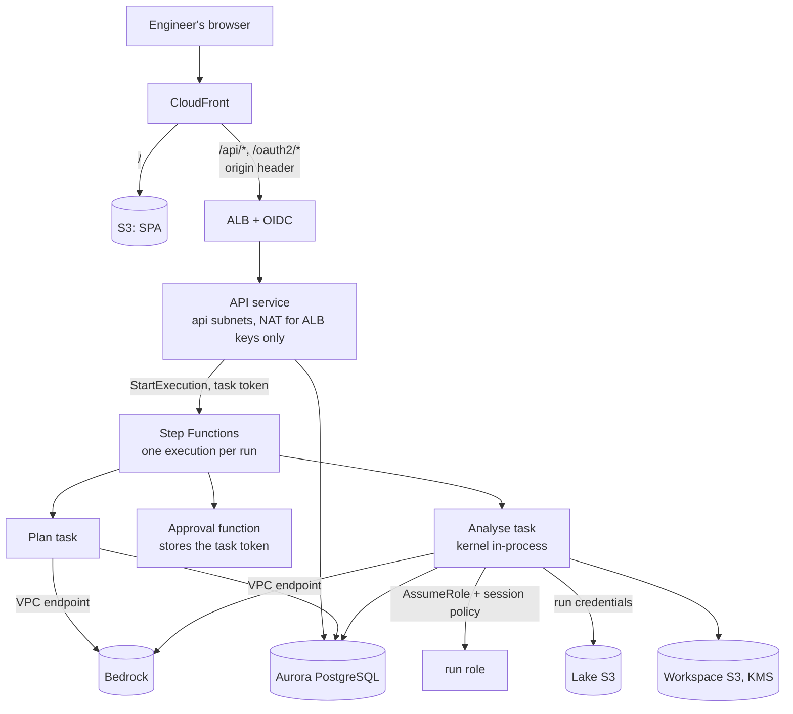

# Deploy to AWS

The infrastructure is an [AWS CDK](https://docs.aws.amazon.com/cdk/) app in Python under `infra/`. One stack per
environment (`Alchemist-dev`, `Alchemist-staging`, `Alchemist-prod`) holds everything in the
[technical design](https://claude.ai/code/artifact/22c0c2a8-5aa9-407b-9303-544974b79b6b): the VPC and endpoints,
buckets and KMS key, Aurora PostgreSQL, the ECS services and tasks, the Step Functions run workflow, the credential
broker, CloudFront and the ALB, and alarms.

!!! note

    The code is written and checked with `cdk synth` and tests, but it has not been deployed to an account yet.
    Treat the first deployment to a dev account as part of phase 1 (Foundations) and run the S3 gate below.

## What gets deployed



With `workflow.launcher: queue`, the API puts each step in the run queue in Aurora instead of starting an execution,
and an ECS service of workers (`alchemist worker`, the analyse task's role, image and size) takes them. Warm workers
start a step in seconds. The API sends the queue's backlog to CloudWatch every 30 seconds and the service runs one
worker per `workflow.workers.concurrency` waiting or running steps, between `workflow.workers.min_count` (0 is allowed:
the first step then waits about a minute for a task) and `max_count`. It needs `sandbox_mode: in_process`. See
[Running many runs](../concepts/runs.md#running-many-runs-in-the-background).

With `workflow.sandbox_mode: separate`, the analyse task drives a sandbox task in the sandbox subnets instead, and only
the sandbox gets data credentials, from the broker Lambda (refreshed as they expire). See
[Deployment contract](../reference/deployment.md#two-sandbox-modes).

| Piece | Where it is | Notes |
| --- | --- | --- |
| VPC | `network.py` | public (ALB), api, app, sandbox and data subnets; one NAT gateway routed only from the api subnets (`network.api_egress`); interface endpoints for ECR, logs, Lambda, Secrets Manager, Bedrock, STS, Step Functions, ECS, KMS, CloudWatch; S3 gateway endpoint limited to Alchemist's buckets, the lake and the ECR layer bucket |
| Buckets and key | `storage.py` | workspace, knowledge, Bedrock invocation logs (all SSE-KMS with one customer key), web (SPA), logs |
| Database | `database.py`, `services.py` | Aurora PostgreSQL 17 Serverless v2, encrypted, in the data subnets: the catalog, run index and audit log, shared by every API and worker task; only their security groups reach port 5432 |
| Bedrock | `bedrock.py` | guardrail with a sensitive-information filter, invocation logging to the Alchemist bucket, model allow-list on roles and on the VPC endpoint |
| Services | `services.py` | ECS cluster, image, roles, task definitions (api, orchestrator, sandbox, sealer, indexer), API service behind the ALB, broker Lambda, nightly indexers; with `workflow.launcher: queue`, the worker service and its scaling on the queue's backlog |
| Run workflow | `workflow.py` | run: Plan, WaitForApproval, Analyse (or the separate-sandbox steps); replay: Replay; plus the approval function |
| Edge | `edge.py` | CloudFront with the SPA and `/api/*`, `/oauth2/*` routed to the ALB; optional Route 53 records |
| Operations | `observability.py` | alarms to an SNS topic, CloudTrail with S3 data events on the workspace bucket, optional break-glass role whose every use alarms |

## How the design's rules are enforced

| Rule | Enforced by |
| --- | --- |
| A run reads only its datasets and writes only its own folder | the run role, narrowed per run by a session policy (assumed by the analyse task in-process, or by the broker for a separate sandbox) |
| The orchestrator calls Bedrock but cannot read the lake | separate mode: the orchestrator role has no lake permission and is denied `inputs/` and `work/`. In-process mode the analyse task holds both, so this rule rests on the app |
| The sandbox reads the lake but cannot call Bedrock or the internet | separate mode: no route out of the sandbox subnets; the Bedrock endpoint's security group admits only app security groups; the sandbox role can only invoke the broker |
| Only the API reaches the internet, for the ALB signing keys | the NAT route exists only in the api subnets |
| A run reads only its user's plants and writes only its own folder | the broker assumes the run role with a session policy built from the run's grant |
| Sealed runs cannot change | workspace bucket policy: only the run, orchestrator and sealer roles (and break-glass) may write in run folders; run credentials expire; no role may write `SEALED` except the sealer; optional Object Lock |
| Only approved models | allow-listed ARNs on the roles and on the Bedrock endpoint policy |
| Only CloudFront reaches the API | the ALB answers 403 unless the request carries the origin secret header, then authenticates with OIDC |

## Prerequisites

- An AWS account per environment, with Bedrock model access granted for the models you allow-list, and application
  inference profiles for the lead and sub models in one geography.
- Node.js 20+ for the CDK CLI (`npx aws-cdk@2`), [uv](https://docs.astral.sh/uv/), and Docker for building the image
  (or a pushed image, see below).
- An OIDC app in your identity provider with the callback URL `https://<domain.name>/oauth2/idpresponse` and a
  `groups` claim carrying the `alc-plant-<code>`, `alc-global`, `alc-ws-<area>`, `alc-catalog-admin` and `alc-admin`
  groups ([Access](../concepts/access.md)). Store its client secret in Secrets Manager under the name in
  `oidc.client_secret_name`. See [Single sign-on](single-sign-on.md) for a OneLogin walkthrough.
- Two ACM certificates: one in `us-east-1` for `domain.name` (CloudFront), and one in the stack's region covering both
  `domain.name` and `domain.api_origin_name` (ALB).
- The data team's agreement that the lake buckets' KMS keys allow the run and indexer roles to decrypt (open
  question 7).

## Configure an environment

Copy `infra/config/dev.yaml` to `infra/config/<env>.yaml` and replace every value marked `placeholder`. The file is
validated on load, so a typo fails at synth time. The main sections:

| Section | Holds |
| --- | --- |
| `account`, `region` | the target account and region |
| `network` | the CIDR and zones of a new VPC, or `existing:` subnet and route-table ids of a landing-zone VPC (see `config/example-existing-vpc.yaml`) |
| `lake` | lake bucket names, their KMS key ARNs, and `plant_prefix_template` |
| `storage` | bucket names, versioning and Object Lock (open question 1), `work/` expiry, whether data is retained on stack deletion |
| `oidc` | issuer, endpoints, client id, client-secret name, scope, group claim |
| `domain` | the user-facing name, the ALB origin name, certificates, optional Route 53 zone and CloudFront prefix list |
| `bedrock` | `lead_model`, `sub_model` (inference profile ARNs), embedding model, `allowed_model_arns`, invocation logging, guardrail |
| `image` | empty to build from the repository `Dockerfile`, or `ecr_repository_arn` and `digest` for a scanned image |
| `sizes`, `database`, `workflow` | task sizes, Aurora capacity, approval and analysis timeouts, the nightly index schedule |
| `commands` | the container commands; see [Deployment contract](../reference/deployment.md) |
| `modules` | optional parts of the stack: `edge`, `observability`, `indexers` |
| `plugins` | app plugins installed into the image and selected for every container, and infrastructure plugins; see [Extend the deployment](#extend-the-deployment) |
| `operations` | alarm e-mail, log retention, CloudTrail, break-glass principals |

!!! warning

    `bedrock.invocation_logging` sets the account-wide invocation-logging configuration of the region. Turn it off
    if other teams use Bedrock in the same account and already configure logging.

## Synthesize and test

```bash
cd infra
uv sync --extra dev
uv run pytest -q                               # template security checks and broker tests
npx aws-cdk@2 synth -c env=dev --quiet         # needs no AWS credentials
npx aws-cdk@2 synth -c config=path/to/other.yaml
```

CI runs both on every pull request.

## Deploy

```bash
cd infra
npx aws-cdk@2 bootstrap aws://<account>/<region>     # once per account and region
npx aws-cdk@2 diff   -c env=dev
npx aws-cdk@2 deploy -c env=dev
```

After the first deployment:

1. **Access rules.** Upload the access file (plant groups, workspaces, identity-claim mapping) to
   `s3://<WorkspaceBucket>/_config/access.yaml` ([Access](../concepts/access.md)).
2. **Catalog.** Register and index the pilot datasets with the indexer task
   (`aws ecs run-task --cluster <ClusterName> --task-definition <IndexerTaskDefinition> --launch-type FARGATE
   --network-configuration ... --overrides '{"containerOverrides":[{"name":"indexer","command":["catalog","index"]}]}'`).
   When the app moves to Postgres, run `db migrate` the same way first.
3. **DNS.** Without `domain.hosted_zone_id`, create `domain.name` as an alias to `DistributionDomain` and
   `domain.api_origin_name` as an alias to `AlbDns`.
4. **Alarms.** Confirm the SNS e-mail subscription if `operations.alarm_email` is set.
5. **Gate for phase 1.** Start a run as a user of plant A only and check at S3 (CloudTrail data events) that its
   sandbox is denied when reading a plant-B prefix.

## Extend the deployment

The stack has three layers, so a site can add to it without forking `infra/`:

| Layer | What | How to change it |
| --- | --- | --- |
| Core | network, storage, database, Bedrock, services, run workflow | always on; holds the security rules |
| Modules | `edge` (CloudFront and the SPA), `observability` (alarms, CloudTrail, break-glass), `indexers` (nightly schedules) | switch off in `modules:`, for example when the company already has a front door or central logging |
| Plugins | app plugins in the image; infrastructure plugins that add AWS resources | `plugins:` in the environment file |

### App plugins

[App plugins](plugins.md) are Python packages installed next to `alchemist` in the image. List them in
`plugins.packages` (pip specs; pin versions, or give a wheel path inside the repository) and the image is built with
them through the `EXTRA_PACKAGES` build argument. Select what loads with `plugins.enabled` (`ALC_PLUGINS`; empty means
built-ins only, which is the safe default), `plugins.modules` (`ALC_PLUGIN_MODULES`) and `plugins.access_provider`
(`ALC_ACCESS_PROVIDER`). `plugins.env` adds settings a plugin reads. All of these reach every container, so the API,
orchestrator, sandbox and indexers load the same plugins. With a pinned image (`image.digest`), bake the packages into
that image instead; the config refuses both at once.

```yaml
plugins:
  packages: ["acme-alchemist==1.2.0"]
  enabled: [acme]
  access_provider: alb-oidc
```

### Infrastructure plugins

An infrastructure plugin is a Python module with `register(ctx)`, named in `plugins.infra` or installed with the
entry-point group `alchemist.infra`. It runs after the core and the modules, and gets an `InfraContext` with the
config and every construct (`ctx.network`, `ctx.storage`, `ctx.services`, `ctx.workflow`, ...). Use
`ctx.scope(name)` for its resources, `ctx.services.add_task(...)` for a task on the Alchemist image,
`ctx.allow_s3_bucket(name)` to let tasks reach another bucket through the S3 endpoint, and, sparingly,
`ctx.allow_run_writer(role_arn)` for a role that must write inside run folders. Endpoint and sealing policies are
finalised after the plugins, so these calls take effect. `infra/tests/sample_infra_plugin.py` is a working example;
the stack output `InfraPlugins` lists what was loaded.

```toml
# pyproject.toml of a site package
[project.entry-points."alchemist.infra"]
acme = "acme_infra:register"
```

## Promote to staging and prod

The same code deploys each environment from its own config file. A release reaches prod only after the benchmark
passes in staging (technical design, Operations). Pin the image by digest (`image.ecr_repository_arn` and
`image.digest`) in staging and prod so a manifest's image digest names exactly what ran.

## Known gaps

- The default deployment keeps the kernel inside the analyse task; `sandbox_mode: separate` is built but has not run
  in an AWS account yet, so try it in dev first. `knowledge ingest` is not a command yet, so that nightly schedule fails until it is.
- The broker token travels in the execution input and the sandbox task's environment, so people who can read
  execution history or describe ECS tasks (the orchestrator role can) can see it. Only the sandbox role may invoke the
  broker, and the token is bound to one run and expires with the grant.
- The sandbox's kernel API has no authentication of its own; only the orchestrator's security group reaches it.
- WAF on CloudFront, Bedrock Guardrails being passed on each model call, S3 Access Grants (for lakes not split by
  plant prefix), cross-region replication, and an alarm for writes to sealed prefixes are not in this stack yet.
- The app connects to Aurora as the cluster's admin user with a password, over TLS (`sslmode=require`, without
  verifying the RDS certificate). A least-privilege app role, IAM database authentication and `verify-full` with the
  RDS CA bundle are not in this stack yet.
- The NAT gives the API task general HTTPS egress, not only to the ALB key endpoint. An egress proxy or AWS Network
  Firewall with a domain allow-list would narrow it to `public-keys.auth.elb.<region>.amazonaws.com`.
