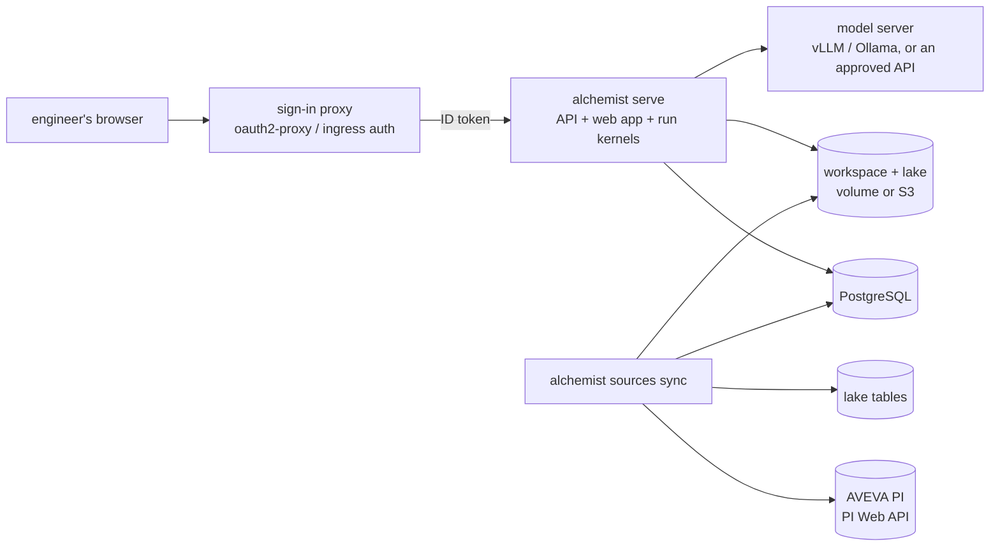

# Deploy on-prem or in your cloud

For a pilot, Alchemist runs where the plant's data already is: on one server in the plant network with docker
compose, or in the customer's own Kubernetes cluster (EKS, AKS, GKE, OpenShift, on-prem) with the Helm chart. Both use
the same image, `ghcr.io/kausalflow/alchemist`, and neither needs AWS. (The AWS-native architecture, with a Step
Functions workflow per run and separate sandbox tasks, is in [Deploy to AWS](deploy-aws.md).)

| | docker compose | Helm |
| --- | --- | --- |
| Where | one Linux server or VM (8+ cores, 32 GB; a GPU if the model runs there too) | the customer's cluster |
| Database | bundled PostgreSQL 17 | theirs (RDS, Azure Database, Cloud SQL, CloudNativePG ...) |
| Run folders and lake | a local volume, or their S3-compatible store | their S3 or S3-compatible store |
| Models | bundled Ollama (`--profile local-llm`), any server in the network, or an approved cloud API | a model server in the cluster or network, optional bundled Ollama, or an approved cloud API |
| Sign-in | pick a user (`dev`, trial only) or the plant's identity provider (`oidc`) | the plant's identity provider (`oidc`) |
| Data sources | `sync` service every 15 minutes | CronJob every 15 minutes |



## docker compose

Everything is in [`deploy/compose`](https://github.com/kausalflow/alchemist/tree/main/deploy/compose).

```bash
git clone https://github.com/kausalflow/alchemist && cd alchemist/deploy/compose
cp .env.example .env        # set POSTGRES_PASSWORD, ALC_PSEUDONYM_KEY, the models and sign-in
$EDITOR config/access.yaml  # plants, workspaces and users (or group mapping)
$EDITOR config/sources.yaml # PI servers and lake tables to sync
docker compose --profile local-llm up -d    # or without the profile, with a model server you already have
```

Open `http://<server>:8000`. Then:

1. `docker compose exec api alchemist sources check` reaches each source; the `sync` service starts reading them.
2. In the web app, **Admin → the plant → Data sources**: approve each drafted card once (see
   [Data sources](data-sources.md#catalog-cards)).
3. Put plant documents (operating procedures, P&ID notes, known issues) into `config/knowledge/`.
4. Ask a question.

To try it without plant data first, load the synthetic demo into the same stack:

```bash
docker compose exec -e ALC_ACCESS=/data/access.yaml -e ALC_KNOWLEDGE=/data/knowledge api \
  sh -c "alchemist demo setup && alchemist demo run"
```

The stack keeps run folders and the lake on the `alchemist-home` volume. To use the plant's object store (AWS S3,
MinIO, Ceph, NetApp StorageGRID ...), set `ALC_WORKSPACE`, `ALC_LAKE` and the `AWS_*` variables in `.env`.

`deploy/compose/smoke.sh` is the end-to-end check CI runs on every change: the stack comes up on PostgreSQL, the demo
investigation runs, replays and verifies, and a PI source syncs from a fake PI Web API into the lake and the catalog.

## Helm

The chart is in [`deploy/helm/alchemist`](https://github.com/kausalflow/alchemist/tree/main/deploy/helm/alchemist).
It expects a PostgreSQL database, an S3-compatible bucket for the workspace and the lake, and a Secret with the
credentials:

```bash
kubectl create namespace alchemist
kubectl -n alchemist create secret generic alchemist \
  --from-literal=ALC_PSEUDONYM_KEY="$(openssl rand -hex 32)" \
  --from-literal=ALC_DB_PASSWORD=... \
  --from-literal=PI_WEBAPI_PASSWORD=...          # and AWS_* keys if the pods have no workload identity
helm install alchemist deploy/helm/alchemist -n alchemist -f my-values.yaml
```

```yaml
# my-values.yaml
image: {tag: "0.1.0"}               # pin a release or digest
database: {host: alchemist.postgres.plant.internal}
storage:
  workspace: s3://plant-alchemist-workspace
  lake: s3://plant-alchemist-lake
  endpoint: https://s3.plant.internal  # leave empty for AWS S3
serviceAccount:
  annotations: {eks.amazonaws.com/role-arn: arn:aws:iam::123456789012:role/alchemist}  # or GKE/AKS workload identity
models:
  planning: local:qwen3:32b
  analysis: local:qwen3:32b
  reviewer: local:qwen3:32b
  small: local:qwen3:32b
  localUrl: http://vllm.ml.svc:8000/v1
auth:
  oidc:
    issuer: https://login.microsoftonline.com/<tenant-id>/v2.0
    audience: <client-id>
access: |
  plants: [P01]
  workspaces:
    quality: {plants: [P01]}
  identity:
    group_aliases: {"5f1c...": alc-plant-P01}   # Entra ID sends group ids
sources: |
  sources:
    - {id: p01-pi, plant: P01, kind: pi, url: https://pi.plant.internal/piwebapi, auth: basic,
       username: svc-alchemist, data_server: PISRV01, tag_filter: "L2.*", backfill: 90d}
ingress:
  enabled: true
  className: nginx
  annotations:
    nginx.ingress.kubernetes.io/auth-url: https://$host/oauth2/auth
    nginx.ingress.kubernetes.io/auth-signin: https://$host/oauth2/start?rd=$escaped_request_uri
    nginx.ingress.kubernetes.io/auth-response-headers: Authorization
  hosts: [{host: alchemist.plant.internal, paths: ["/"]}]
```

The chart runs:

- the **API** (one replica, `Recreate`): the web app, the REST API and the runs, each analysis in its own kernel
  process; a `db migrate` init container applies schema migrations first;
- the **sync** CronJob (`sync.schedule`), `concurrencyPolicy: Forbid`;
- optionally **Ollama** as a StatefulSet with a GPU (`ollama.enabled`), when the cluster has no model server yet.

Pods run as uid 10001, non-root, without privilege escalation. The workspace and the lake need the S3 API; for Google
Cloud Storage use its XML API with HMAC keys (`storage.endpoint: https://storage.googleapis.com`). Lake *sources* can
be on GCS or Azure natively: the sync reads them there and writes the copy to the S3 lake.

## Sign-in

`ALC_AUTH=dev` lets anyone who reaches the API act as any user in `access.yaml`. Use it for a trial on one machine
only. For a pilot, use `oidc`: a sign-in proxy signs users in with the plant's identity provider and forwards the ID
token, which Alchemist verifies itself. Groups map to plants and workspaces as everywhere else. See
[Single sign-on](single-sign-on.md#any-oidc-provider-outside-aws).

## Keeping plant data in the network

With `local:` models and `ALC_ALLOWED_PROVIDERS=local`, no prompt, query result or document leaves the network: the
allow-list refuses every other provider before a request is sent, and admins cannot pick one on the Models page. The
image also ships DuckDB's S3 extensions, so nothing is downloaded at run time. What still needs network access:

| From | To | Why |
| --- | --- | --- |
| API | the model server | planning, analysis, review |
| API | the identity provider's keys (`jwks_uri`) | verifying ID tokens; or serve them locally with `ALC_OIDC_JWKS_URL` |
| API, sync | PostgreSQL, the object store | catalog, runs, lake |
| sync | PI Web API, lake sources | reading plant data (read-only) |
| the host | `ghcr.io` | pulling the image; or mirror it into the plant's registry |

## What this deployment does not enforce yet

Compared with the [AWS architecture](deploy-aws.md), the compose and Helm deployments run each analysis kernel inside
the API container (`ALC_SANDBOX_MODE=in_process`). The kernel's SQL is still read-only and limited to approved datasets,
and every result is sealed, but the kernel runs with the API's network access and storage credentials. Restrict the
pod's or host's egress (a Kubernetes NetworkPolicy, or the plant firewall) to the destinations above. Per-run storage
credentials (`ALC_RUN_ROLE_ARN`) need AWS STS and are off here.
