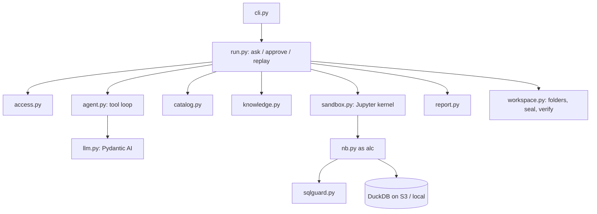

# Code layout

```text
src/alchemist/
  cli.py        the `alchemist` command
  config.py     settings from environment variables
  access.py     plant groups and workspaces from identity-provider claims or access.yaml; which plants a run may read
  credentials.py  per-run STS credentials and their session policy (the credential broker)
  catalog.py    registry, catalog cards (drafted by a model or a heuristic), search, suggestions, run index, audit
  sqlguard.py   read-only SQL guard on DuckDB's parser
  nb.py         helpers used inside the kernel as `alc` (query, finding, align, effect, check_results)
  sandbox.py    one Jupyter kernel per run; every call becomes a notebook cell
  llm.py        model access through Pydantic AI (Bedrock, Anthropic, Gemini, OpenAI), provider allow-list
  agent.py      tool loop with budgets and a transcript; ScriptedModel for offline runs
  prompts.py    system prompts and tool definitions (their hash goes into each manifest)
  run.py        ask / approve / replay lifecycle and the tool handlers
  report.py     conclusion card and HTML report, filled from findings
  workspace.py  S3 (or local) folder layout, sealing and verification
  knowledge.py  document passages and structured knowledge
  paths.py      cloudpathlib helpers, DuckDB on S3, conditional writes, ULIDs, hashing, glob expansion
  demo/
    generate.py synthetic plant with a planted root cause
    script.py   the scripted investigation used by `demo run` and the tests
tests/          pytest suite, including an end-to-end run, replay and verify
```

## How the pieces call each other



The orchestration (`run.py`, `agent.py`, `llm.py`) talks to the model; everything that touches data runs in the kernel
through `nb.py`. In the target design these become two containers, so raw rows never sit in a process that can call the
model.
