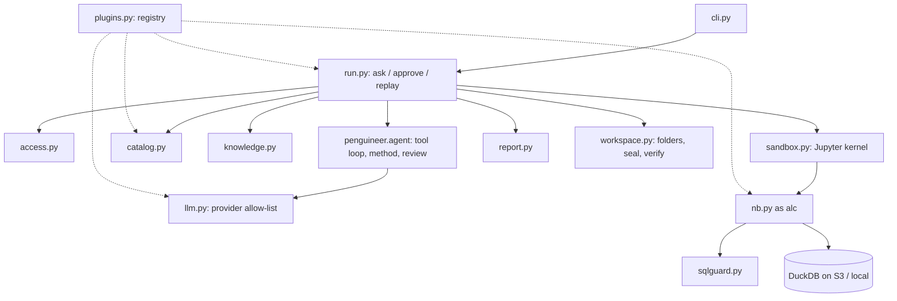

# Code layout

```text
src/alchemist/
  cli.py        the `alchemist` command
  config.py     settings from environment variables
  access.py     plant groups and workspaces from identity-provider claims or access.yaml; which plants a run may read
  credentials.py  per-run STS credentials and their session policy; broker grants and the broker Lambda client
  catalog.py    registry, catalog cards (drafted by a model or a heuristic), search, suggestions, run index, audit
  sqlguard.py   read-only SQL guard on DuckDB's parser
  nb.py         helpers used inside the kernel as `alc` (query, finding, penguineer, align, effect, check_results)
  sandbox.py    one Jupyter kernel per run (local, or a separate sandbox's); every call becomes a notebook cell
  sandbox_server.py  `alchemist sandbox serve`: the kernels' HTTP API (a sandbox task per run, or one sandbox service)
  fsjail.py          Landlock: a kernel confines itself to its run's datasets and folder
  llm.py        which providers may see plant data (allow-list) and the models built for them; calls go through penguineer.agent
  agent.py      re-exports penguineer's tool loop (`ToolOutput` and friends) for plugins
  prompts.py    system prompts (penguineer's method plus Alchemist's tools) and tool definitions; their hash goes into each manifest
  penguineer_tools.py  penguineer's commands as analysis tools, schemas from its Params models
  run.py        ask / approve / replay lifecycle and the tool handlers
  report.py     conclusion card and HTML report, placeholders filled by penguineer.agent
  workspace.py  S3 (or local) folder layout, sealing and verification
  sources.py    data sources (AVEVA PI, lake tables) synced into the lake with penguineer's connectors, registered and drafted
  knowledge.py  plant documents and structured knowledge; which plants a run may read (search is penguineer's)
  paths.py      cloudpathlib helpers, DuckDB S3 secret, conditional writes, ULIDs, hashing, glob expansion
  plugins.py    plugin registry and extension-point types; the built-in defaults are registered here
  api/
    app.py      FastAPI app: session routes, plugin routers, serving the built web app
    runs.py     questions and runs: ask, approve, events, stop, contents, replay, verdicts
    catalog.py  catalog browsing, suggestions and admin
    identity.py who is calling (dev header, the load balancer's OIDC token, or any provider's ID token) and their groups
    jobs.py     launchers that run plan, analysis and replay steps outside the request
    deps.py     per-request services, the signed-in user, entitlement checks
  demo/
    generate.py synthetic plant with a planted root cause
    script.py   the scripted investigation used by `demo run` and the tests
tests/          pytest suite, including an end-to-end run, replay and verify, and the API
web/            React single-page app (Vite, TypeScript) over the REST API
  src/pages/    Ask, Runs, Run, Catalog, Dataset, Catalog admin, About
  src/runTabs.tsx  registry of run page tabs
infra/          AWS CDK app (its own pyproject), see guides/deploy-aws.md
  app.py        entry point: `cdk synth -c env=dev` reads config/dev.yaml
  config/       one YAML file per environment; every account-specific value lives here
  alchemist_infra/
    config.py        validated settings (pydantic)
    stack.py         one stack per environment wiring the constructs below
    network.py       VPC tiers, security groups, VPC endpoints and their policies
    storage.py       KMS key, workspace/knowledge/web/log buckets, sealing bucket policy
    database.py      Aurora PostgreSQL Serverless v2
    bedrock.py       guardrail, invocation logging, model allow-list
    services.py      ECS cluster, image, roles, task definitions, API service and ALB, broker, indexers
    workflow.py      Step Functions run workflow
    edge.py          CloudFront for the SPA and the API
    observability.py alarms, CloudTrail, break-glass role
    plugins.py       InfraContext and loading of infrastructure plugins
    lambdas/broker/  per-run credential broker (boto3 only)
  tests/        template security checks and broker tests
examples/
  alchemist-example-plugin/   a working plugin of most extension kinds (see guides/plugins.md)
```

## How the pieces call each other



The orchestration (`run.py` with penguineer's tool loop, `llm.py`) talks to the model; everything that touches data runs in the kernel
through `nb.py`. In the target design these become two containers, so raw rows never sit in a process that can call the
model.
